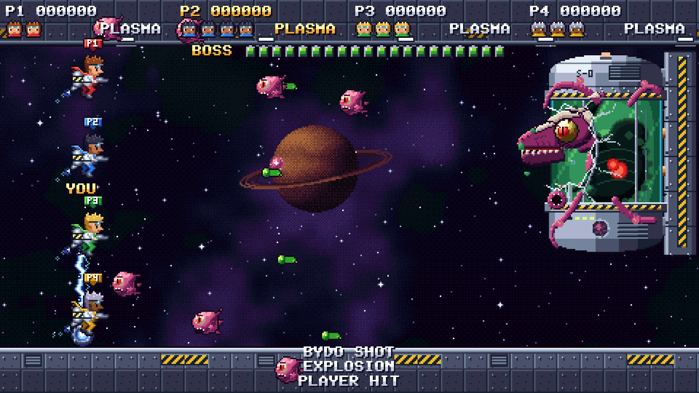
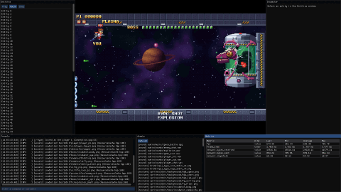
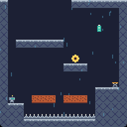

<h1 align="center">R-Type</h1>

<p align="center">
  <strong>A networked shoot'em up for up to four players, built on a modular C++ game engine.</strong>
</p>

<p align="center">
  <a href=".assets/r-type-gameplay.png">
    
  </a>
</p>

<p align="center">
  <em>Four players against the Incubator. The server runs the game; each client sends its inputs and draws the snapshots.</em>
</p>

## What is here

| Folder | What it is |
|---|---|
| `younity-engine/` | A modular 2D engine in C++23: ECS, scripting, physics, audio, network and an in-game editor |
| `j-type/` | The R-Type game: a headless server and an SFML client |
| `j-climb/` | A precision platformer written in Lua on the same engine |

## Screenshots

| Engine editor and debug tools | J-Climb, the second game |
| :---: | :---: |
| [](.assets/r-type-editor.png) | [](.assets/j-climb-room8.png) |

## How it works

J-Type is server-authoritative. The server owns the world, runs the gameplay at a fixed step and sends UDP snapshots sixty times a second. Each client sends the keys held down, draws the snapshots two steps behind and predicts its own ship. The protocol, the wave format and the technical study are in [`j-type/docs/`](j-type/docs/index.md).

The engine is 13 modules, each its own library. A game links only what it uses. J-Type links most of them in C++; J-Climb is a platformer written almost entirely in Lua through the scripting module. The two games share no code.

## Run it

Requirements: CMake 3.21 or newer and a C++23 compiler. The first configure fetches the dependencies with CPM. On Linux, SFML needs a few system headers:

```sh
sudo apt install libx11-dev libxrandr-dev libxcursor-dev libxi-dev libudev-dev libgl-dev
```

Build J-Type and J-Climb from the game folder:

```sh
cd j-type
cmake --preset default
cmake --build --preset default
```

Start a server, then one client per player:

```sh
./r-type_server 4242
./r-type_client localhost 4242
```

The client opens on the main menu. The Konami code on that menu starts J-Climb, which the build writes next to the client with its assets.

See [`BUILD.md`](BUILD.md) for the standalone builds, the tests and the documentation.

## Docs

- [J-Type](j-type/docs/index.md): architecture, protocol RFC, technical study and accessibility.
- [Younity Engine](younity-engine/docs/index.md): modules and API reference.
- [J-Climb](j-climb/README.md): controls and the engine modules it uses.
- [BUILD.md](BUILD.md), [CREDITS.md](CREDITS.md)

## Academic notice

EPITECH students: do not copy this code. Using it as your own work is cheating and can lead to disciplinary action.
