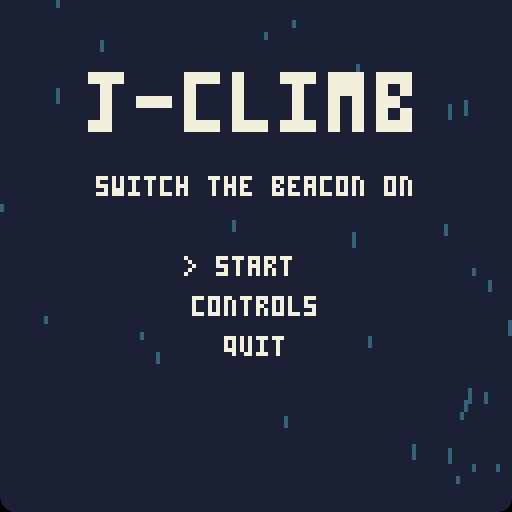
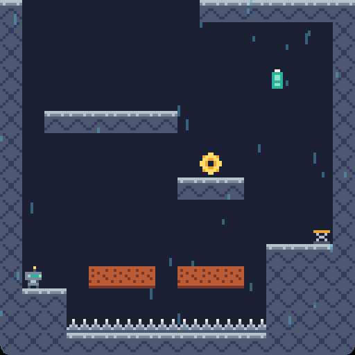

# J-Climb

J-Climb is a small precision platformer written in Lua on the [Younity engine](../younity-engine/README.md), the second game of the engine after [J-Type](../j-type/README.md). A robot climbs a steel tower in the rain, through ten rooms, to switch its beacon on.

| | |
|---|---|
|  |  |

Run, jump, slide down the walls and jump off them, and dash once in the air: the lamp of the antenna is lit while the dash is ready. Springs, crumbling blocks, moving platforms and batteries make up the rooms, and each one hides a gear. J-Type starts J-Climb with the Konami code on its main menu.

## Controls

| Action | Keyboard        | Gamepad    |
|--------|-----------------|------------|
| Move   | Arrows          | Left stick |
| Jump   | C or Space      | A          |
| Dash   | X or Left Shift | X          |
| Pause  | Escape          | Start      |

## Build

```sh
cmake --preset default
cmake --build --preset default
./j-climb
```

The `default` preset builds the engine from `../younity-engine`. The `tests` preset builds the Criterion tests, which play a run through the ten rooms.

## What it uses of the engine

J-Climb shares no code with J-Type: it only links the modules of the engine.

| Module      | Used for                                                                      |
|-------------|-------------------------------------------------------------------------------|
| `core`      | The main loop at a fixed step, and its time scale for the pause               |
| `ecs`       | The entities, the movement of the rain and the sparks, the scene file         |
| `physics`   | The hitboxes and the collisions with spikes, springs, batteries, gears and the beacon |
| `render`    | The window drawn at 128x128, and the sprites                                  |
| `input`     | The actions, bound by the names of the keys from `controls.lua`              |
| `scripting` | The whole game in Lua, with modules, hot reload and the saved best time       |
| `audio`     | The sounds and the music, played by the scripts                               |
| `assets`    | The textures and the sounds, loaded by their path                             |

The game is in `assets/scripts/`: save a script while the game runs to try a change at once.

## License

J-Climb is under the MIT license, see [LICENSE](LICENSE). Its sprites, sounds and music are made for it by `tools/sprites.py` and `tools/sounds.py`, under the same license.
