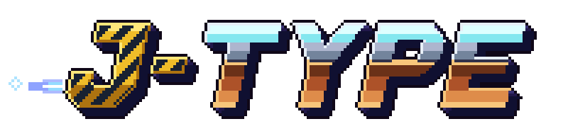

<p align="center">
  
</p>

# J-Type

J-Type is an R-Type for up to four players over the network, written in C++23 on the [Younity engine](https://github.com/Rimapus/r-type/tree/main/younity-engine).

A server runs the game: it moves the ships, the missiles and the Bydos, and decides what they hit. Each player plays in a client, which sends the keys held down and draws the snapshots the server sends sixty times a second.

| Part      | Folder    | What it does                                                          |
|-----------|-----------|-----------------------------------------------------------------------|
| Server    | `server/` | Runs the game, applies the inputs of the clients, sends the snapshots |
| Client    | `client/` | Sends the inputs of the player, draws the snapshots                   |
| Common    | `common/` | The components, the gameplay rules and the network messages, shared by both |

## Requirements

- Linux or Windows. We also develop on macOS.
- A C++23 compiler. We use Clang 20, and clang-cl on Windows.
- CMake 3.21 or newer.

CMake fetches the libraries of the engine with [CPM](https://github.com/cpm-cmake/CPM.cmake). The engine and J-Climb are in the same repository, next to this folder, so a fresh clone is enough. On Linux, SFML also needs a few system headers:

```sh
sudo apt install libx11-dev libxrandr-dev libxcursor-dev libxi-dev libudev-dev libgl-dev
```

## Build

```sh
cmake --preset default
cmake --build --preset default
```

The `default` preset builds the engine from `../younity-engine` and J-Climb from `../j-climb`. The binaries, `r-type_server` and `r-type_client`, are written at the root of `j-type/`, next to the `assets` folder they read.

## Play

Start the server on a UDP port, then one client per player with the address of the server and the same port:

```sh
./r-type_server 4242
./r-type_client localhost 4242
```

A difficulty can follow the port: `./r-type_server 4242 easy` gives each player 5 lives and Bydo shots 30% slower and two thirds as often; `hard` gives 2 lives and shots 25% faster, a third more often; `normal`, the default, gives 3 lives.

The client opens on the main menu: PLAY joins the server, HELP recalls the goal of the game and its controls with the keys bound, SETTINGS sets the volume of the music and of the sounds. A game holds four players: each client gets the first free ship.

| Key        | Gamepad       | Action |
|------------|---------------|--------|
| Arrow keys | Left stick    | Move   |
| Space      | First button  | Shoot  |
| M          | Fourth button | Mute or unmute the sound |
| Escape     | Second button | Leave the game |
| F1         |               | Show or hide the debug windows of the engine |
| F2         |               | Show or hide the editor of the engine |

These are the defaults: SETTINGS, then CONTROLS, binds each action to another key and another gamepad input; RESET gives the defaults back. Escape and the second button stay kept for going back, F1 and F2 for the windows of the engine. In the menus, the arrow keys or the left stick move, Enter or the first button confirms, Escape or the second button goes back, whatever the bindings. SETTINGS also switches on the captions of the sounds, for the players who cannot hear them, the auto fire, which shoots without holding the key, the correction of the colors of the window for protanopia, deuteranopia or tritanopia, the high contrast, which darkens the starfield, and REDUCE FLASHES, which draws the explosions smaller and dimmer. The settings are kept in `settings.txt`, in `~/.config/j-type/` on Linux, `~/Library/Application Support/J-Type/` on macOS and `%APPDATA%\J-Type\` on Windows.

In the debug and editor layouts (F1, F2), `help` in the console lists the commands of the engine and of the game: `quit`, `menu`, `mute`, `volume music 50`, `colorblind deuteranopia`, `captions on`, `autofire on`, `contrast on`, `pause`, `play`, `step`, `metrics` and `log.level <logger> <level>`.

The server has a console too, typed in its terminal: one command per line, its answer in the log. `help` lists them: `players` (the address, the score, the lives and the last input of each player), `kick <1-4>` (takes a player out; its client goes back to the menu once its connection times out, after 3 seconds), `restart` (a new game), `waves` (the wave played and the next one), `difficulty [easy|normal|hard]` (tells or changes it: the Bydo shots follow at once, the lives at the next game), `stop`, `metrics` and `log.level <logger> <level>`.

## Tests

```sh
cmake --preset tests
cmake --build --preset tests
```

The `tests` preset builds the [Criterion](https://github.com/Snaipe/Criterion) tests and runs them. On Linux, Criterion is downloaded with the other dependencies; on macOS, install it first with `brew install criterion`.

## Fuzzing

The message codec has a [LibFuzzer](https://llvm.org/docs/LibFuzzer/) harness, built with Clang:

```sh
cmake --preset fuzz
cmake --build --preset fuzz
mkdir -p build/fuzz/work
./build/fuzz/fuzz_messages build/fuzz/work fuzz/corpus -runs=1000
```

`fuzz/corpus` holds the seed datagrams. The fuzzer writes the inputs it finds to the folder given first, so that one stays in `build/`.

## Documentation

The documentation is in [`docs/`](docs/index.md): getting started, architecture, technical study, protocol RFC and accessibility. The engine has its own, with its modules and its API reference: [`../younity-engine/docs/`](../younity-engine/docs/index.md).

It is built from the `docs/` folder. To read it on your machine:

```sh
pip install -r docs/requirements.txt
mkdocs serve
```

## Part 2 track

For the second part of the project, the team chose the **advanced architecture** track: build a real game engine, generic and standalone, rather than a game with its engine inside.

- The [Younity Engine](../younity-engine/README.md) is in `../younity-engine`: its modules are libraries, and J-Type links the ones it needs through CPM.
- [J-Climb](../j-climb/README.md), a platformer written in Lua, is a second game built on it that shares no code with J-Type. The Konami code on the main menu starts it.
- The client carries the tools of the engine: F1 shows its debug windows and F2 its editor.

The [Part 2 track section](../younity-engine/README.md#part-2-track) of the engine lists what it does and where each part is described.

## Contributing

Issues and pull requests are welcome. The original project used GitLab merge requests and a GitLab CI pipeline; this repository keeps the sources, the tests and the documentation.

## Authors

See [CREDITS.md](../CREDITS.md).

Questions and bug reports are welcome in the [issue tracker](https://github.com/Rimapus/r-type/issues).

## License

J-Type is under the MIT license, see [LICENSE](LICENSE).
