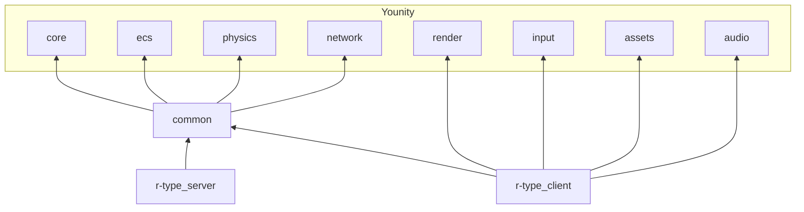
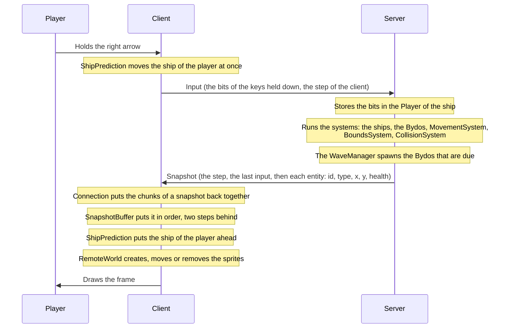
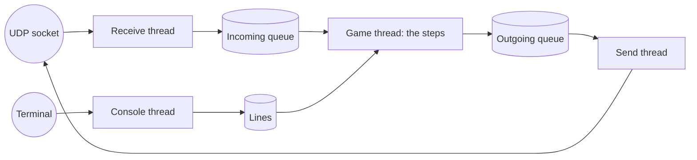

# Architecture

J-Type is two programs built on one library of shared code, all three on the Younity engine. This page shows how they fit together, the path of one step through them, where the code lives, and how to add a new kind of enemy.

## The layers



The diagram reads from the bottom to the top: an arrow goes from a part to a part it uses. The modules of the engine are explained in the [engine documentation](https://github.com/Rimapus/r-type/blob/main/younity-engine/docs/architecture/index.md).

| Layer   | Target          | What it holds                                                          |
|---------|-----------------|------------------------------------------------------------------------|
| Engine  | `Younity::*`    | Math types, the ECS, collisions, UDP and packets, drawing, input       |
| Common  | `JType::Common` | The components of the game, the network messages, the shared constants |
| Server  | `r-type_server` | The game: its systems, its spawning, its rules                         |
| Client  | `r-type_client` | The window: the screens, the keys of the player, the drawing of the snapshots and the HUD |

The server needs no window: it links the engine modules of `common` only, so it runs on a machine without a display. The client draws and plays the sound, and links `render`, `input`, `assets` and `audio` on top.

## One step, from a key to the screen

Both programs run the fixed step of the engine, 60 times a second (`TICK_STEP`).



1. **Input.** At each step, the client reads the keys held down (`Controls`) and sends them in an `Input` message: one bit per key (`Input.hpp`), and the step of the client, which grows by one at each `Input`. `ShipPrediction` moves the ship of the player with them at once, with the movement code of the server (`moveShip`).
2. **Server step.** The server reads every datagram received since the last step and stores the bits in the `Player` of the ship of that client, unless a newer `Input` of that client came first. A client silent for 3 seconds loses its slot and its ship. While no client is in the game, the systems and the waves wait, so the first players to join find the game at its start. Then it runs its systems in order: `PlayerMovementSystem` moves the ships with the bits and `ShootSystem` fires their missiles, or the three pellets of the spread shot, `EnemyMovementSystem` and `EnemyShootSystem` move the Bydos along their pattern and fire theirs, `BossSystem` moves the boss and fires its orbs and spits, `InvulnerabilitySystem` counts down the invulnerability of a ship back in the game, `LifetimeSystem` removes the explosions, the engine's `MovementSystem` moves every entity with a velocity, `BoundsSystem` keeps the ships on screen and removes what left it, and the engine's `CollisionSystem` publishes a `CollisionEvent` for each pair of touching hitboxes, which the server turns into the rules of the game (`resolveCollision`): a ship takes the power-up it touches, a Bydo carrying one leaves it where a player shot it, and the ceiling, the floor, the walls and the zappers hurt the ships and stop the missiles. The ceiling and the floor stay along the whole game, from `spawnTerrain`, and are not sent in the snapshots. Then the `WaveManager` brings the Bydos and the boss that are due, from `assets/data/waves.txt`. The game is over when every player is out of lives, and won when the boss is destroyed.
3. **Snapshot.** The server sends each client the number of the step and the step of its last input, then the id, the type, the position and the health of each entity. A snapshot too large for a datagram is split into numbered chunks; the client's `Connection` puts them back together. After the snapshot, the server sends the events of the step: the entities that appeared or went, the scores earned, the deaths, the power-ups taken and the end of the game.
4. **Drawing.** The client's `SnapshotBuffer` keeps the snapshots in the order of their step, and gives the world two steps before the newest one, each entity moved between the snapshot before and the one after. In that world, `ShipPrediction` puts the ship of the player where the newest snapshot has it, moved by the inputs sent since. `RemoteWorld` keeps one sprite per id: it creates the sprite of a new id, moves the known ones, and removes the ids that are gone. A ship with more health than `PLAYER_HEALTH` has a shield, and gets a bubble around it. The game screen draws the ceiling and the floor itself, scrolling at `STAGE_SPEED` like the walls and the zappers. The engine's `AnimationSystem` moves the animation of each sprite forward, and the window draws them, over the scrolling star field.

## The server threads

The server runs on one thread for the game, two for the network and one for its console. The `UdpPump` of the engine owns the socket: a receive thread pushes each datagram into a queue, and a send thread sends what the game queued. The game thread never waits for the network: at each step it empties the incoming queue with `tryReceive`, and `sendTo` only queues the bytes. The console thread (`ConsoleInput`) reads the lines typed in the terminal of the server into a queue too, and the game thread runs them at each frame with the console of the engine, see the [security study](../study/security.md#the-administration-console).



Only the queues are shared between the threads, so the registry and the systems need no lock.

## The screens

The client shows one screen at a time. Each one is a scene of the engine's `SceneManager`, with its own registry: the screen left is destroyed at the start of the next step, with its sprites.

| Screen    | Scene           | What it does |
|-----------|-----------------|--------------|
| Main menu | `MenuScene`     | The first screen. PLAY joins the server given on the command line, HELP opens the help, SETTINGS opens the settings, QUIT closes the client. |
| Help      | `HelpScene`     | The goal of the game and each action with its key and its gamepad input, as bound in the settings (`getHelpLines`), then the keys of the menus and of the layouts. BACK goes back to the main menu. |
| Settings  | `SettingsScene` | Left and right change the volume of the music and of the sounds by 10, from 0 to 100, heard at once, and switch the captions of the sounds, the auto fire, the high contrast and REDUCE FLASHES on or off, and choose the color blindness the colors of the window are corrected for. REDUCE FLASHES draws the explosions at two thirds of their size and half see-through (`getFlashLook`). CONTROLS opens the bindings. BACK saves them. |
| Controls  | `ControlsScene` | Each action of the game with its key and its gamepad input. Confirm on an action waits for the next key or gamepad input and binds it; Escape or the back button cancels. RESET gives back the defaults, BACK goes back to the settings. |
| Game      | `GameScene`     | Opens the socket and joins the server, then runs the steps above. Back leaves the game. |
| Game over | `GameOverScene` | The last scoreboard and GAME OVER, or VICTORY once the boss is beaten. PLAY AGAIN joins the server again, MENU goes back to the main menu. |

The menus are moved through with the arrows, Enter and Escape, or with the left stick and the first two buttons of a gamepad. The directional pad is not bound: SFML gives its vertical axis a different sign on Windows and on Linux. The selected line is amber and between dashes, so it is told apart without its color.

On the main menu, the Konami code, up up down down left right left right, starts [J-Climb](https://github.com/Rimapus/r-type/blob/main/j-climb/README.md), the second game built on the engine, a platformer written in Lua. It is built from `../j-climb` with the client: `cmake/JClimb.cmake` writes it to `j-climb/j-climb`, next to the client, with its assets in `j-climb/assets/`, and packages that folder with the game. The client starts it as its own program from the folder of the client, whatever folder the client runs from, given the path of its assets, and keeps running; the code does nothing while J-Climb still runs, and a missing J-Climb is only logged.

Back, a full server or a lost server take the player back to the main menu, which writes the reason under the title. The end of the game takes the player to the game over screen. Leaving the game screen sends `Leave`. A client that joins during the game over waits in the game for the next one, which the server starts after `GAME_OVER_DELAY`, instead of being sent to the game over screen of a game it did not play.

The settings are read at start and written when the settings screen is left, to `settings.txt` in the configuration folder of the user: `$XDG_CONFIG_HOME/j-type/` or `~/.config/j-type/` on Linux, `~/Library/Application Support/J-Type/` on macOS, `%APPDATA%\J-Type\` on Windows. Each line is `<name> <value>`, and a missing or invalid value keeps its default:

```text
# The settings of the J-Type client, written by its settings screen
music_volume 100
effects_volume 100
captions 0
auto_fire 0
colorblind OFF
high_contrast 0
key_up UP
pad_up Y-
...
key_mute M
pad_mute B3
```

A key is written with its name on the controls screen, a gamepad button with `B` and its number, and a side of an axis with the axis and `-` or `+`. A key or a gamepad input taken from another action swaps with it, so no action is left without one and no key presses two actions (`rebindKey`, `rebindGamepad`). Escape and the back button are never bound: they leave the game and go back in the menus. F1 and F2 are never bound either: they show the layouts of the engine.

## Debug and editor layouts

The client lays out the windows of the engine's editor with its `Workspace` (`Client`). F1 (`DEBUG_LAYOUT_KEY`) shows the debug layout: the game in the whole window, with the version and the frame rate at the top left, the metrics at the top right and the console along the bottom. The metrics show the lag and the bandwidth of the client: the round trip of the pings (`network.latency`) and the datagrams of the server that never came (`network.packets_lost`), from the engine's session, and, each second, the bytes sent and received and the snapshots received (`network.bytes_sent`, `network.bytes_received`, `network.snapshots`), from the `TrafficMeter` of the `Connection`. The server counts its own traffic the same way and logs it every 10 seconds (`TRAFFIC_LOG_PERIOD`). F2 (`EDITOR_LAYOUT_KEY`) shows the editor layout: the game in a preview at the top center, the entities and the scene file on its left, the inspector on its right, the console, the assets and the metrics along the bottom. The same key goes back to the game, and the other key switches straight to the other layout.

The windows are fixed in place and follow the size of the window. Before each step, the client asks the workspace if the game has the keyboard and the gamepad (`Controls::setEnabled`): always in the game layout, in the debug layout unless the command line of the console is typed in, and in the editor layout once the preview is clicked, until a window of the editor is clicked. Without them, no action is pressed, in the menus too.

The Pause button of the editor stops the screen shown: the menus stand still, and the game screen stops drawing the game while it keeps its session and sends its inputs, because the server goes on with the other players and drops a client silent for 3 seconds. The snapshots received in the meantime are dropped, so Play goes back to the live game, and Step shows the next step the server sends.

The editor shows no Scene window in the client: the world of a game comes from the server, so a scene file loaded under it would not match the entities the screens hold, nor the next snapshot. The client registers the components of the engine with the resource manager of `Assets`, so the inspector shows the texture of a sprite by its path.

## Colorblind and high contrast

The four players are told apart by their tag and their look, not only by their color (see [The sprites](#the-sprites)), but their colors are red, blue, green and yellow: under the simulations of Machado, Oliveira and Fernandes (2009), the middle shades of two players are only 18.1 Delta E (CIE76) apart with protanopia (P3 and P4), 10.3 with deuteranopia (P1 and P3) and 22.0 with tritanopia (P2 and P3).

COLORBLIND corrects the colors of the whole window for one color blindness: PROTANOPIA, DEUTERANOPIA or TRITANOPIA. Each mode is a 3x3 matrix given to the window of the engine (`Window::setColorMatrix`), which applies it to every pixel of the game with a shader: the daltonization of Fidaner, Lin and Ozguven (2005), which moves the colors lost to the color blindness to the channels still seen and keeps the grays (`getColorblindMatrix`). The closest players then go to 36.9 Delta E with protanopia, 26.1 with deuteranopia and 26.1 with tritanopia, under the same simulations. Without shaders, the colors stay as they are and the client says so on its error output.

HIGH CONTRAST draws the starfield at a third of its brightness (`DIMMED_STARFIELD`), through the color of its sprites, so the ships, the Bydos and the shots stand out from the background.

## The sprites

The game draws the 16-bit set of `assets/sprites/16bit/` instead of the sheets given with the subject: it has one color per player, and every ship, Bydo, shot and effect in the same style.

Each image is a sheet of frames of the same size. `assets/data/sprites.txt` names each animation of a sheet, one per line:

```text
# <name> <path> <width> <height> <columns> <first> <count> <duration> <loop|once> <origin x> <origin y> <layer>
player_p1 sprites/16bit/player/player_p1.png 40 36 6 0 6 0.1 loop 24 19 2
```

The frames are numbered from 0, left to right then top to bottom, `columns` on a row, as the `GridLayout` of the engine. The client reads the file once through the engine's `ResourceManager`, then builds the sprite of an entity from its type alone: `getSpriteName` gives the name of the line, and the line gives the texture, the `AnimationClip`, the origin and the layer.

The four players are told apart by more than a color. Each slot has its own `EntityType` for its ship and for its missiles (`Player1` to `Player4`, `Missile1` to `Missile4`), so a shot has the color of the player who fired it. Over each ship, `RemoteWorld` draws the tag of its player, `P1` to `P4`, and writes `YOU` in amber under the ship of this client: `layoutPlayerMarker` places them.

## The sounds

The client plays a music in a loop and a sound for each main action. The sounds come from the events of the server. The game screen keeps them in an `EventBuffer` until the world it draws reaches their step, then plays them before that world is drawn, so a sound comes with what appears on the screen, and `getEventSound` (`SoundCues`) finds the sound of each one. The events are kept no longer than the snapshots: while the editor pauses the game, both are dropped.

| Sound          | Played when                                       | File in `assets/audio/` | Caption |
|----------------|---------------------------------------------------|-------------------------|---------|
| Shot of a player | A `Spawn` of a `Missile1` to `Missile4` or a `SpreadPellet1` to `SpreadPellet4` | `sounds/player_shot.wav` | None   |
| Shot of a Bydo | A `Spawn` of an `EnemyMissile`, an `IncubatorOrb` or an `IncubatorSpit` | `sounds/enemy_shot.wav` | `BYDO SHOT` |
| Explosion      | A `Spawn` of an `Explosion` or an `IncubatorWreck` | `sounds/explosion.wav` | `EXPLOSION` |
| Hit            | A `DeathEvent` of a ship whose player plays on    | `sounds/player_hit.wav` | `PLAYER HIT` |
| Out            | A `DeathEvent` of a ship whose player is out      | `sounds/player_out.wav` | `PLAYER OUT` |
| Game over      | A `GameOverEvent` of a lost game                  | `sounds/game_over.wav` | None    |

The music stops when the game is over and starts again from the beginning with the next game or on the main menu. The mute action, M or the fourth gamepad button by default, mutes the music and the sounds, on every screen. The volume of each sound and of the music is a constant in `client/src/audio/Audio.cpp`, scaled by the volumes of the settings.

For the players who cannot hear them, CAPTIONS in the settings writes a line at the bottom of the game screen for each sound that tells something, whether the sound is muted or not (`Captions`). A line stays 2 seconds after the last time its sound was heard (`CAPTION_DURATION`) and fades out during the last half second (`CAPTION_FADE`), through the color of its sprites; a sound heard again keeps its single line, opaque again, instead of adding one. The shot of a player and the game over have no caption: the shots are on screen, and the game over opens its own screen. The captions are off by default.

The other events are written over the game. A `PlayerDisconnected` writes `P2 DISCONNECTED` centered under the HUD, in the color of that player (`PLAYER_COLORS`), for 3 seconds, at most 3 lines with the newest at the bottom (`Notices`). A `ScoreEvent` writes `+100` where that player destroyed a Bydo in the same step, in the color of the player, rising and fading out in 0.8 second (`Popups`). The top of the screen tells what happened in the game and the bottom what is heard, so a notice is never taken for a caption, and the `P2` reads without its color.

### Where the sounds come from

Every file comes from OpenGameArt under [CC0](https://creativecommons.org/publicdomain/zero/1.0/): it is in the public domain, so the game can use, change and share it without asking or crediting anyone. The files are copied unchanged, only renamed after what they play.

| File in `assets/audio/`  | Original file                                                    | Source |
|--------------------------|------------------------------------------------------------------|--------|
| `sounds/player_shot.wav` | `Weapons/Lasers/sfx_wpn_laser2.wav`                              | [512 Sound Effects (8-bit style)](https://opengameart.org/content/512-sound-effects-8-bit-style), by Juhani Junkala |
| `sounds/enemy_shot.wav`  | `Weapons/Lasers/sfx_wpn_laser8.wav`                              | The same pack |
| `sounds/explosion.wav`   | `Explosions/Short/sfx_exp_short_hard1.wav`                       | The same pack |
| `sounds/player_hit.wav`  | `General Sounds/Negative Sounds/sfx_sounds_damage1.wav`          | The same pack |
| `sounds/player_out.wav`  | `Explosions/Medium Length/sfx_exp_medium1.wav`                   | The same pack |
| `sounds/game_over.wav`   | `General Sounds/Negative Sounds/sfx_sounds_negative1.wav`        | The same pack |
| `music/space_battle.ogg` | `space_battle_bpm130.ogg`                                        | [Space Battle](https://opengameart.org/content/space-battle), by MintoDog |

The pack holds 512 sounds in 44.1 kHz, 16-bit mono WAV, with its license in its `INFO.txt`. To change a sound, pick another file of the pack, copy it over the one of the table, and update its line. A new source must be CC0 too, or its license must be checked first.

## Where the code lives

| What                         | Where                                         |
|------------------------------|-----------------------------------------------|
| Components of the game       | `common/include/jtype/common/components/`     |
| Network messages, encoding   | `common/include/jtype/common/Messages.hpp`, `common/src/Messages.cpp` |
| Bytes and snapshots per second | `common/src/TrafficMeter.cpp`               |
| Entity types of the snapshots | `common/include/jtype/common/EntityType.hpp` |
| Keys of the input bitmask    | `common/include/jtype/common/Input.hpp`       |
| Size of the game, step       | `common/include/jtype/common/Constants.hpp`   |
| Server loop, rules, snapshots | `server/src/Server.cpp`                      |
| Administration console of the server | `server/src/Commands.cpp`, `server/src/ConsoleInput.cpp` |
| Systems of the game          | `common/src/systems/`                         |
| Creating ships, missiles, Bydos | `common/src/Spawn.cpp`                     |
| Speeds, sizes, delays        | `common/include/jtype/common/Gameplay.hpp`    |
| Difficulty: lives, Bydo shots | `common/src/Difficulty.cpp`, `server/src/main.cpp` |
| Waves of Bydos               | `assets/data/waves.txt`, `common/src/Waves.cpp`, `common/src/WaveManager.cpp` |
| Boss: movement, attacks, rules | `common/src/systems/BossSystem.cpp`, `common/src/Combat.cpp` |
| Power-ups: carriers, drop, pick-up | `common/src/WaveManager.cpp`, `common/src/Combat.cpp` |
| Ceiling, floor, walls, zappers | `common/src/Spawn.cpp`, `common/src/Combat.cpp`, `client/src/render/Sprites.hpp` |
| Client loop                  | `client/src/Client.cpp`                       |
| Screens: menu, help, settings, game, game over | `client/src/scenes/`        |
| Fewer flashes                | `client/src/render/Flashes.cpp`, `client/src/world/RemoteWorld.cpp` |
| Lines of the menus           | `client/src/scenes/Menu.cpp`                  |
| Konami code, J-Climb         | `client/src/scenes/KonamiCode.cpp`, `client/src/system/JClimb.cpp`, `client/src/system/Process.cpp`, `cmake/JClimb.cmake` |
| Captions of the sounds       | `client/src/scenes/Captions.cpp`              |
| Bindings of the actions      | `client/src/input/Bindings.cpp`               |
| Color corrections for the color blindnesses | `client/src/settings/Colorblind.cpp` |
| Settings file                | `client/src/settings/Settings.cpp`            |
| Session, slot, inputs to the server | `client/src/network/Connection.cpp`    |
| Keys of the player and of the menus | `client/src/input/Controls.cpp`        |
| Debug and editor layouts     | `client/src/Client.cpp`                       |
| Sprites and their animations | `assets/data/sprites.txt`                     |
| Sprite of each entity type   | `getSpriteName` in `common/src/SpriteSheets.cpp` |
| Textures and sprites loaded once | `client/src/render/Assets.cpp`            |
| Snapshots in order, interpolated | `client/src/world/SnapshotBuffer.cpp`     |
| Ship of the player, predicted | `client/src/world/ShipPrediction.cpp`        |
| Snapshots to sprites         | `client/src/world/RemoteWorld.cpp`            |
| Tags and YOU over the ships  | `client/src/render/PlayerMarker.cpp`          |
| Sounds of the events         | `client/src/audio/SoundCues.cpp`              |
| Events until their step is drawn | `client/src/world/EventBuffer.cpp`        |
| Notices, points and power-ups over the game | `client/src/scenes/Notices.cpp`, `client/src/scenes/Popups.cpp` |
| Music, sounds and volumes    | `client/src/audio/Audio.cpp`                  |
| HUD: scores, lives, weapons, game over, health of the boss | `client/src/render/Hud.cpp`, `client/src/render/HudLayout.cpp` |
| Texts and icons over the game | `client/src/render/Overlay.cpp`              |
| Tests                        | `tests/<area>/`                               |

## How to add a kind of enemy

A kind of enemy is known by the server, which creates and moves it, and by the client, which draws it. The snapshots link the two through its `EntityType`.

1. **Name it on both sides.** Add a value to `EntityType` in `common/include/jtype/common/EntityType.hpp`. It is a byte of the snapshots: add it at the end, so the values already sent keep their meaning. Accept it in `isValidEntityType`, in `common/src/Messages.cpp`, or the client drops the snapshots that hold it, and add it to the table of the RFC (`docs/rfc/j-type-protocol.xml`).
2. **Give it its rules.** Add a value to `EnemyType` in `common/include/jtype/common/components/Enemy.hpp`, then its health, its points, its movement pattern and whether it shoots in `getMaxHealth`, `getKillPoints`, `getMovementPattern` and `canShoot`, in `common/src/Spawn.cpp`: `spawnBydo` builds it with them.
3. **Bring it into the waves.** Give it a name in `parseType`, in `common/src/Waves.cpp`, then use that name in the groups of `assets/data/waves.txt` (see [Write a wave](../guides/write-a-wave.md)).
4. **Send its type.** In `toEntityType`, in `server/src/Server.cpp`, give its `EnemyType` its `EntityType`, so the client knows what it is.
5. **Draw it.** If its sprite is not in `assets/data/sprites.txt` yet, add a line: the file of the sheet in `assets/sprites/`, the size of a frame, the frames of the animation, its speed, its origin and its layer. Then give its `EntityType` the name of that line in `getSpriteName`, in `common/src/SpriteSheets.cpp`.
6. **Test it.** Add a test in `tests/` for what is new: its creation, its movement or its rules.

The client needs no other change: `RemoteWorld` creates the animated sprite of any type that `getSpriteName` knows. A test checks that every `EntityType` has a sprite and that every animation fits in its image.
