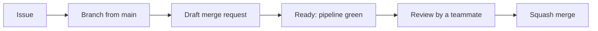

# Contributing

This page describes how the team worked on J-Type during the project, and what the original GitLab pipeline checked. The same rules apply to the engine, see the [Younity contribution guide](https://github.com/Rimapus/r-type/blob/main/younity-engine/docs/contributing/index.md). This repository keeps the sources, the tests and the documentation; the GitLab configuration is not included.

## From an issue to `main`

Every change starts from an issue and reaches `main` through a reviewed merge request.



1. **Issue.** Its title is `[SCOPE] What it does`, e.g. `[GAMEPLAY] Enemy waves`. The scope is a part of the game (`CLIENT`, `SERVER`, `COMMON`, `GAMEPLAY`, `PROTOCOL`, ...) or a cross-cutting area (`DOCS`, `BUILD`, `ACCESSIBILITY`, ...).
2. **Branch.** Created from `main`, named `type/scope-what-it-does`, e.g. `feat/gameplay-play-enemy-waves-from-a-data-file`. The scope is left out for cross-cutting work: `docs/write-the-readme`.
3. **Draft merge request.** Opened as soon as the branch is pushed, titled `Draft: type(scope): what it does`, with `Closes #<issue>` in its description so the issue closes at the merge.
4. **Ready.** Once the pipeline is green, the merge request leaves the draft state and a teammate reviews it. Nobody merges their own merge request.
5. **Merge.** The merge request is squashed into one commit on `main`, and its branch is deleted.

`main` is protected: nobody pushes to it directly.

## Commit messages

Commits follow [Conventional Commits](https://www.conventionalcommits.org/en/v1.0.0/): `type(scope): what it does`, in the imperative, without a final period.

| Type       | For                                   |
|------------|---------------------------------------|
| `feat`     | A new behaviour                       |
| `fix`      | A bug fix                             |
| `refactor` | A change of the code, not of what it does |
| `docs`     | The documentation                     |
| `test`     | The tests alone                       |
| `chore`    | Tooling, CI, dependencies             |

```text
feat(client): add the scrolling star-field background
docs: write the README
```

## Labels and milestones

Each issue gets labels of three kinds:

| Kind     | Labels                                                                 |
|----------|------------------------------------------------------------------------|
| Type     | `feature`, `bug`, `docs`, `test`, `refactor`, `chore`                  |
| Area     | `client`, `server`, `common`, `gameplay`, `protocol`, `assets`, `build`, `accessibility` |
| Priority | `critical`, `high priority`, `medium priority`, `low priority`         |

`in progress` marks an issue someone works on, and `blocked` one that waits on another. The milestones follow the parts of the project: **Part 0: Common** for the work evaluated at every defense, like the documentation, **Part 1: Architecture & prototype** and **Part 2: Advanced topics**.

## Code style

The code is C++23. The style is the one of the engine, written in its [code style page](https://github.com/Rimapus/r-type/blob/main/younity-engine/docs/contributing/code-style.md), with the same `.clang-format` and `.clang-tidy`:

- `PascalCase` for the types, `camelCase` for the functions and the variables, `_camelCase` for the private members, `UPPER_CASE` for the constants, and the `jtype` namespace.
- A member is reached through `this->`, a function without parameters is written `name(void)`, and every `if` or loop body has braces.
- Every public class and function has a Doxygen comment; a comment inside a function says why, not what.
- Each file starts with the `EPITECH PROJECT` header block.
- The shared code lives in `common/include/jtype/common/` and `common/src/`, the server in `server/src/`, the client in `client/src/`, and the tests in `tests/<area>/`.

Run the same checks locally before pushing:

```sh
# Formatting: lists the lines to change, fails on the first one
find client common server tests -type f \( -name '*.cpp' -o -name '*.hpp' \) -print0 | xargs -0 clang-format --dry-run --Werror

# Static analysis, on the compile commands of the default preset
cmake --preset default
find client common server -type f -name '*.cpp' -print0 | xargs -0 -n1 clang-tidy -p build/default --quiet --header-filter='.*/(client|common|server)/.*'
```

`clang-format -i <file>` fixes the formatting of a file. The original pipeline used `clang-format-20` and `clang-tidy-20`.

## What the original pipeline checked

The original GitLab pipeline ran on each merge request. The jobs that did not concern the changed files were skipped: a documentation change did not build the game.

| Job             | Stage   | What it checks                                               |
|-----------------|---------|--------------------------------------------------------------|
| `format`        | check   | clang-format on `client`, `common`, `server` and `tests`     |
| `tidy`          | check   | clang-tidy on the sources                                    |
| `docs`          | check   | The documentation website builds with `mkdocs build --strict` |
| `build-linux`   | build   | The game builds with Clang 20 on Linux                       |
| `build-windows` | build   | The game builds with clang-cl on Windows                     |
| `tests-linux`   | test    | The Criterion tests pass, and their coverage                 |

On `main`, the original pipeline published this website. On a version tag like `v1.2.3`, its `package-linux` and `package-windows` jobs built the archives of the game.

## Writing the documentation

The website is built with MkDocs and the Material theme, from `docs/` and `mkdocs.yml`. A new page goes in the `nav` of `mkdocs.yml`: a page outside it fails the strict build. Check a change with:

```sh
pip install -r docs/requirements.txt
mkdocs build --strict
```

## Writing the protocol RFC

The protocol is specified in `docs/rfc/j-type-protocol.xml`, in [RFCXML v3](https://authors.ietf.org/), and published as
the text and the HTML generated by `xml2rfc`. After a change to the wire format, rebuild both and the website:

```sh
pip install -r docs/requirements.txt
xml2rfc --text --out docs/rfc/j-type-protocol.txt docs/rfc/j-type-protocol.xml
xml2rfc --html --out docs/rfc/j-type-protocol.html docs/rfc/j-type-protocol.xml
mkdocs build --strict
```

The RFC describes what the codec and the server do: when the two disagree, the code is right and the RFC is fixed.

## Working with the engine

The game and the engine are in the same repository, next to each other. The game adds the engine from `../younity-engine` with CPM, so a change that needs both is built from `j-type`:

```sh
cmake --preset default
cmake --build --preset default
```

The engine is never copied or patched inside the game.
