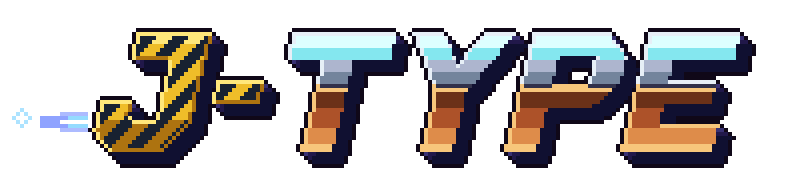

---
hide:
  - navigation
  - toc
---

{ .hero-logo }

# A networked shoot'em up in C++23

J-Type is an R-Type for up to four players over the network, built on the [Younity engine](https://github.com/Rimapus/r-type/blob/main/younity-engine/docs/index.md). A server runs the game, and each player plays it in a client.

[Get started](getting-started/index.md){ .md-button .md-button--primary }
[Younity documentation](https://github.com/Rimapus/r-type/blob/main/younity-engine/docs/index.md){ .md-button }

## The game

Up to four ships fly from left to right and shoot the Bydos coming from the right of the screen. The server decides everything: where the ships go and what the missiles hit. Sixty times a second it sends every client a snapshot of the game, which the client draws.

| Part      | Folder    | What it does                                                        |
|-----------|-----------|---------------------------------------------------------------------|
| Server    | `server/` | Runs the game, applies the inputs of the clients, sends the snapshots |
| Client    | `client/` | Sends the inputs of the player, draws the snapshots                 |
| Common    | `common/` | The components, the gameplay rules and the network messages, shared by both |

The engine is a library of its own: the game links its modules, and the engine documentation explains them.

## Part 2 track

For the second part of the project, the team chose the **advanced architecture** track: build a real game engine, generic and standalone, rather than a game with its engine inside.

- The [Younity Engine](https://github.com/Rimapus/r-type/tree/main/younity-engine) is a separate CMake project: its modules are libraries, and J-Type adds it through CPM from the sibling folder.
- [J-Climb](https://github.com/Rimapus/r-type/tree/main/j-climb), a platformer written in Lua, is a second game built on it that shares no code with J-Type. The Konami code on the main menu starts it.
- The client carries the tools of the engine: F1 shows its debug windows and F2 its editor.

The [Part 2 track section](https://github.com/Rimapus/r-type/blob/main/younity-engine/docs/index.md#part-2-track) of the engine documentation lists what it does and where each part is described.
