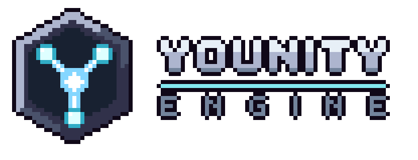

<p align="center">
  
</p>

# Younity Engine

Younity is a 2D game engine written in C++23.

It is a set of libraries that any 2D game can link. Two games are built on it:

| Game                                                         | What it is                                     | What it shows of the engine                                     |
|--------------------------------------------------------------|------------------------------------------------|-----------------------------------------------------------------|
| [J-Type](https://github.com/Rimapus/r-type/tree/main/j-type)    | A networked shoot'em up for up to four players | The network module, a server and a client, written in C++       |
| [J-Climb](https://github.com/Rimapus/r-type/tree/main/j-climb)  | A precision platformer in ten rooms            | A game written almost entirely in Lua through the scripting module |

The two games share no code: each one links the modules it needs from this folder.

## Modules

The engine is split into modules. Each one is a library, so a game only links what it uses.

| Module      | What it does                                              |
|-------------|-----------------------------------------------------------|
| `logger`    | Log messages with levels, to the console or to a file     |
| `core`      | Math types, clock and fixed timestep, events, main loop   |
| `tools`     | Metrics, console variables and commands                   |
| `plugin`    | Shared libraries loaded at run time                       |
| `ecs`       | Entities, components, systems and scenes                  |
| `scripting` | Lua scripts that give an entity its behaviour             |
| `physics`   | Gravity, solids, hitboxes and collision detection         |
| `assets`    | Loading and caching of textures, fonts and sounds         |
| `render`    | Window, sprites, animations, particles and text           |
| `input`     | Keyboard and gamepad, through actions that can be rebound |
| `audio`     | Music and sound effects                                   |
| `network`   | UDP sockets, binary serialization, packets, threaded I/O  |
| `editor`    | Entity list, inspector, scene files, assets, console, metrics, layouts |

`logger` and `core` are always built. The other modules are optional, each with its own switch. A dedicated server, for example, keeps the game logic and the network, and leaves the graphical modules out:

```sh
cmake --preset default -DYOUNITY_BUILD_RENDER=OFF -DYOUNITY_BUILD_INPUT=OFF -DYOUNITY_BUILD_AUDIO=OFF -DYOUNITY_BUILD_EDITOR=OFF
```

## Requirements

- Linux or Windows. We also develop on macOS.
- A C++23 compiler. We use Clang 20, and clang-cl on Windows.
- CMake 3.21 or newer.

The engine uses five libraries: [SFML](https://www.sfml-dev.org) 3 for the window, the graphics, the audio and the input, [Asio](https://think-async.com/Asio/) for the network, [Dear ImGui](https://github.com/ocornut/imgui) with [ImGui-SFML](https://github.com/SFML/imgui-sfml) for the debug interface, [nlohmann/json](https://github.com/nlohmann/json) for the scene files and the plugin configuration, and [Lua](https://www.lua.org) 5.4 with [sol2](https://github.com/ThePhD/sol2) for the scripts. CMake fetches them with [CPM](https://github.com/cpm-cmake/CPM.cmake), so a fresh clone is enough. On Linux, SFML also needs a few system headers:

```sh
sudo apt install libx11-dev libxrandr-dev libxcursor-dev libxi-dev libudev-dev libgl-dev
```

## Build

```sh
cd younity-engine
cmake --preset default
cmake --build --preset default
```

On Windows, configure with `cmake --preset default -T ClangCL`.

## Use it in your game

A game in this repository adds the engine with CPM from the sibling folder, then links the modules it needs. Each module is a target named `Younity::<Module>`. J-Type and J-Climb are the two examples.

```cmake
CPMAddPackage(
    NAME Younity
    SOURCE_DIR "${CMAKE_CURRENT_SOURCE_DIR}/../younity-engine"
)

add_executable(my_game main.cpp)
target_link_libraries(my_game PRIVATE Younity::Core Younity::Render)
```

Outside this repository, replace `SOURCE_DIR` with `GIT_REPOSITORY` and a `GIT_TAG`.

```cpp
#include "younity/render/Window.hpp"

int main(void)
{
    younity::render::Window window(800, 600, "My game");

    while (window.isOpen()) {
        window.pollEvents();
        window.clear();
        window.display();
    }
    return 0;
}
```

This opens a window and keeps it alive until it is closed. From there, the public headers of each module are in `modules/<module>/include`, and `tests/` shows how every part is used.

## Tests

```sh
cmake --preset tests
cmake --build --preset tests
```

The `tests` preset builds the [Criterion](https://github.com/Snaipe/Criterion) tests and runs them. On Linux, Criterion is downloaded with the other dependencies; on macOS, install it first with `brew install criterion`.

## Fuzzing

The packet parser has a [LibFuzzer](https://llvm.org/docs/LibFuzzer/) harness, built with Clang:

```sh
cmake --preset fuzz
cmake --build --preset fuzz
mkdir -p build/fuzz/work
./build/fuzz/fuzz_packet build/fuzz/work fuzz/corpus -runs=1000
```

`fuzz/corpus` holds the seed datagrams. The fuzzer writes the inputs it finds to the folder given first, so that one stays in `build/`.

## Documentation

The documentation is in [`docs/`](docs/index.md): getting started, architecture, guides, and the API reference generated from the code.

It is built from the `docs/` folder. To read it on your machine, with [Doxygen](https://www.doxygen.nl) installed:

```sh
pip install -r docs/requirements.txt
mkdocs serve
```

## Part 2 track

For the second part of the R-Type project, the team chose the **advanced architecture** track: build a real game engine, generic and standalone, rather than a game with its engine inside.

| What the engine does | Where it is described |
|---|---|
| A modular engine: 13 modules, each its own library, that a game links only when it uses them | [Architecture](docs/architecture/index.md) |
| Generic and standalone: J-Type and J-Climb, two games of different kinds, link it and share no code | [The games above](#younity-engine) |
| An entity component system, with scenes saved to and loaded from files | [ECS](docs/architecture/ecs.md) |
| The behaviour of the entities in Lua scripts, run again when their file is saved | [Scripting](docs/architecture/scripting.md) |
| Shared libraries loaded at run time | [Plugin](docs/architecture/plugin.md) |
| An editor and debug tools inside the game: entity list, inspector, scene files, console and metrics | [Editor](docs/architecture/editor.md) |
| A separate CMake project, linked by both games through CPM | [Use it in your game](#use-it-in-your-game) |

## Contributing

Issues and pull requests are welcome. The original project used GitLab merge requests and a GitLab CI pipeline; this repository keeps the sources, the tests and the documentation.

## Authors

See [CREDITS.md](../CREDITS.md).

Questions and bug reports are welcome in the [issue tracker](https://github.com/Rimapus/r-type/issues).

## License

The Younity Engine is under the MIT license, see [LICENSE](LICENSE).
