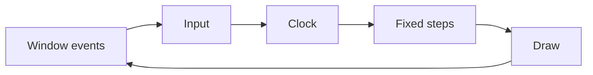

# A frame, step by step

A game is a loop: read what the player does, move the world forward, draw it, and start again. This page follows one turn of that loop and shows which subsystem does each part.

`younity::Application` runs this loop: the game fills its hooks, see [Core](core.md#main-loop). The code below writes it out by hand to show every step.

## The loop

```cpp
younity::render::Window window(800, 600, "My game");
younity::input::InputManager inputs;
younity::ecs::SceneManager scenes;
younity::Clock clock;
younity::FixedTimestep timestep(1.0F / 60.0F);

scenes.changeScene<MenuScene>();
while (window.isOpen()) {
    window.pollEvents();
    inputs.update();

    const float dt = clock.restart();

    for (std::size_t steps = timestep.advance(dt); steps > 0; --steps) {
        scenes.update(timestep.getStep());
    }

    window.clear();
    if (scenes.hasActiveScene()) {
        younity::render::drawEntities(scenes.getActiveScene().getRegistry(), window);
    }
    window.display();
}
```



The diagram shows the five steps of a frame in order: window events, input, clock, fixed steps of the scene, then drawing, before the loop starts again.

## What each step does

**1. Window events.** `pollEvents` handles what the system sent to the window since the last frame. A click on the close button ends the loop.

**2. Input.** `inputs.update()` reads the keyboard and the gamepads once, and stores the state of each action. Every system that asks "is `shoot` pressed?" during this frame gets the same answer.

**3. Clock.** `clock.restart()` gives the time the last frame took, in seconds. It is the delta time, `dt`.

**4. Fixed steps.** The game logic runs in steps of a fixed duration, 1/60 of a second here. `timestep.advance(dt)` tells how many steps fit in the time that passed: usually one, two after a slow frame, zero on a very fast screen. Each step updates the active scene.

**5. Draw.** The window is cleared, `drawEntities` draws the sprites and the texts of the active scene layer by layer, and `display` shows it with the [debug interface](render.md#debug-interface) on top.

Sound has no step of its own. A system plays a sound during a fixed step, and the audio library mixes it on its own thread, see [Audio](audio.md).

Scripts have no step of their own either. The `ScriptSystem` is a system like the others: the scripts run during a fixed step, at the place the game added it in the order of the systems, see [Scripting](scripting.md).

Plugins have no step of their own. The game loads them in `onStart` and calls `PluginManager::update` from a fixed step, where its systems and its scripts run, see [Plugin](plugin.md).

## Inside a step

`scenes.update(step)` is where the game lives. In order:

1. If a new scene was asked with `changeScene`, it becomes the active one and the old one is destroyed.
2. The active scene runs the systems of its registry, in the order they were added. A typical order is input handling, gravity, movement, solid collisions, collisions, then game rules.
3. The entities destroyed by the systems during this step are removed, with all their components.

The order of the systems matters. Gravity comes before movement so the entity moves with its new speed, movement comes before collisions so the collisions are tested on the new positions, and the systems that react to a collision come after the one that detects it.

## Why fixed steps

A game that multiplies everything by a variable `dt` behaves differently at 30 and at 144 frames per second: collisions are missed on slow machines, and two players on the network drift apart. With fixed steps, the simulation receives the same `dt` at every step on every machine, so the same inputs give the same game.

The time left after the last step is kept for the next frame. `timestep.getAlpha()` tells how far the frame is between two steps, for a renderer that wants to draw the entities between their last two positions.
