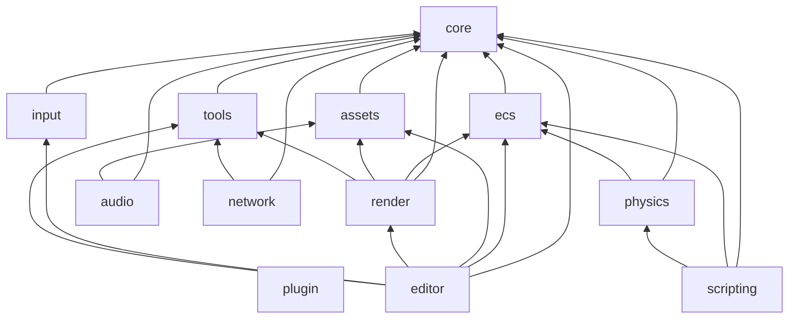

# Architecture

Younity is a set of modules. Each module is a library with its own folder, its own namespace and its own CMake target, so a game links only the ones it uses.

## The modules and what they depend on



The diagram reads from the bottom to the top: an arrow goes from a module to a module it uses. `core` is the base of everything. `tools` is built on `core`. `plugin` loads shared libraries at run time and needs none of the other modules but `logger`. `ecs` is built on `core`. `physics` and `render` are built on `ecs`. `render` and `audio` load their resources through `assets`, and `render` publishes the frame metrics through `tools`. `input` only needs `core`, and `network` uses `core` and publishes its latency and loss through `tools`. `scripting` is built on `ecs`, with `physics` for the collisions. `editor` sits on top, over `ecs`, `render`, the resources of `assets`, the keys of `input` and the metrics and console data in `tools`.

One module is used by all the others and is left out of the diagram to keep it readable: `logger`. Every module links it and gets its own named logger.

These dependencies are declared in the `CMakeLists.txt` of each module, and CMake refuses a module that uses one listed after it:

```cmake
younity_add_module(physics DEPENDS core ecs)
```

## The layers

| Layer        | Modules                       | Role                                                       |
|--------------|-------------------------------|------------------------------------------------------------|
| Foundation   | `logger`, `core`              | Logging, math types, time, events, main loop               |
| Tools        | `tools`                       | Metrics, console variables and commands                    |
| Plugins      | `plugin`                      | Shared libraries loaded at run time                        |
| Game logic   | `ecs`, `scripting`, `physics` | Entities, components, systems, scenes, scripts, collisions |
| Presentation | `assets`, `render`, `audio`   | Resources, drawing, sound                                  |
| Devices      | `input`                       | Keyboard and gamepad                                       |
| Network      | `network`                     | Sockets, serialization, packets, threaded I/O              |
| Editor       | `editor`                      | Entity list, inspector, scene files, assets, console, metrics, layouts |

The game sits on top of these layers. It brings its own components, systems and scenes, and the engine stays the same from one game to the next.

## The subsystems

Each page explains what a subsystem is for, its main types and how to use it.

| Page                              | What it covers                                            |
|-----------------------------------|-----------------------------------------------------------|
| [A frame, step by step](frame.md) | How the subsystems run together in the main loop          |
| [Core](core.md)                   | Math types, clock, fixed timestep, event bus, main loop   |
| [Tools](tools.md)                 | Metrics, console variables and commands                   |
| [Plugin](plugin.md)               | Shared libraries, their lifecycle and configuration       |
| [ECS](ecs.md)                     | Entities, components, systems, scenes                     |
| [Scripting](scripting.md)         | Lua scripts that give an entity its behaviour             |
| [Physics](physics.md)             | Gravity, solids, hitboxes and collision events            |
| [Assets](assets.md)               | Loaders, resource cache and shared resources              |
| [Input](input.md)                 | Actions bound to the keyboard and the gamepad             |
| [Render](render.md)               | The window, sprites, texts, layers, animations, particles |
| [Audio](audio.md)                 | Short sounds, voices, music and volumes                   |
| [Network](network.md)             | UDP socket, binary serialization, packets                 |
| [Editor](editor.md)               | Entity list, inspector, scene files, assets, console and layouts |
| [Logger](logger.md)               | Named loggers, levels and sinks                           |
| [Design decisions](decisions.md)  | The choices behind the engine and their reasons           |

## Where the code is

Every module follows the same layout:

```text
modules/<module>/
├── CMakeLists.txt
├── include/younity/<module>/   public headers
└── src/                        sources
tests/<module>/                 unit tests
```

A header is included with its full path, `#include "younity/ecs/Registry.hpp"`, and its content lives in the namespace of its module, `younity::ecs`. The types of `core` live in `younity`.

## Third-party libraries

| Library                         | Used by                    | For                              |
|---------------------------------|----------------------------|----------------------------------|
| SFML 3                          | `render`, `input`, `audio` | Window, graphics, devices, sound |
| Asio                            | `network`                  | Sockets                          |
| Dear ImGui 1.91, ImGui-SFML 3.0 | `render`, `editor`         | Debug interface, editor windows  |
| nlohmann/json 3.12              | `ecs`, `plugin`            | Scene files, plugin configuration |
| Lua 5.4, sol2                   | `scripting`                | Entity scripts                   |

Each library is private to the modules that use it. A game works with the types of the engine, like `younity::render::Window`, and the library behind them can change while the game stays the same.
