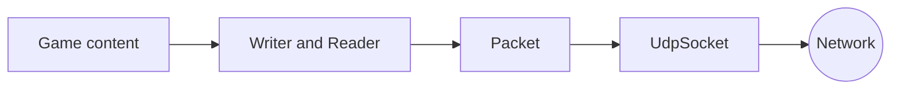

# Network

The `network` module carries bytes between a server and its clients over UDP. It gives four layers, each usable on its own: a socket, a binary serializer, a packet format, and client sessions.

The headers are in `modules/network/include/younity/network/`, in the namespace `younity::network`. The module is built on `core`, and publishes its metrics through `tools`.



The diagram reads from left to right: the game writes its content with the serializer, the content is wrapped in a packet, and the socket sends the packet on the network. Receiving follows the same path in the other direction.

## The socket

`UdpSocket` sends and receives datagrams. `Endpoint` is an address and a port.

```cpp
network::UdpSocket server;

if (!server.bind(4242)) {
    // the port is taken
}
```

`sendTo(bytes, endpoint)` sends a datagram, `receiveFrom(buffer, sender)` waits for one and tells who sent it. The socket is the same class on Linux and Windows.

An `Endpoint` holds an IPv4 address. `Endpoint::resolve` finds it from what a player types, a host name or an address, and refuses an empty host or a host without an IPv4 address with `SocketError::InvalidAddress`. A name is looked up by the system, which can wait on the network, so a game resolves the server once, before its loop.

```cpp
const std::expected<network::Endpoint, network::SocketError> server = network::Endpoint::resolve("localhost", 4242);
```

## Threaded I/O

`UdpPump` wraps a `UdpSocket` with one receive thread and one send thread, so the game loop only calls `sendTo` and `tryReceive`, which never wait. Both queues keep at most `DEFAULT_QUEUE_CAPACITY` (1024) datagrams: a full queue refuses the newest value instead of growing it. `sendTo` returns false when its queue is full, and `getDroppedIncoming()` counts the received datagrams the pump dropped: received while its queue was full, or larger than `MAX_PACKET_BYTES`. The receive buffer has one byte more than a packet, so a larger datagram is caught even where the system cuts it to the size of the buffer. A failing receive is logged at most once a second, with the number of failures since the last warning. A stalled game loop or a peer flooding the port therefore cannot grow the pump's memory without limit. The constructor takes another capacity when a game needs a different frame budget.

```cpp
network::UdpPump pump;  // 1024 datagrams in each queue
network::UdpPump small(64);
```

## The serializer

`Writer` appends fields to a buffer, `Reader` reads them back in the same order. Numbers are written in little-endian, so two machines of different kinds read the same values.

```cpp
network::Writer payload;

payload.putU32Le(42);
payload.putFloatLe(128.5F);
payload.putString("fire");
```

```cpp
network::Reader reader(bytes);

const auto id = reader.getU32Le();        // 42
const auto x = reader.getFloatLe();       // 128.5
const auto action = reader.getString();   // "fire"
```

Every read checks that enough bytes are left. A string is a 16-bit length followed by its bytes, and a length above 256 is refused before any memory is allocated.

## The packet

Every datagram starts with the same header of 8 bytes, followed by the payload.

| Offset | Size | Field    | Content                                               |
|--------|------|----------|-------------------------------------------------------|
| 0      | 2    | Magic    | `0x3659`, the bytes `Y` and `6`                       |
| 2      | 1    | Version  | `1`                                                   |
| 3      | 1    | Type     | `0x01` GameData, `0x02` Ping, `0x03` Pong, `0x80` Connect, `0x81` ConnectAck, `0x82` Heartbeat |
| 4      | 4    | Sequence | A counter kept by the sender                          |
| 8      |      | Payload  | The content of the game, the cookie of a ping, or nothing for a session packet |

A datagram is 1200 bytes at most, which keeps it in one piece on usual networks: `UdpPump` drops a larger one before the game sees it, and `decodePacket` refuses one given another way.

The engine carries the envelope and treats the payload of a `GameData` packet as opaque bytes. Their meaning belongs to the game, so any game can use the same packet layer, and the engine does not validate them. `Ping` and `Pong` carry a 4-byte cookie and measure a round trip. `Connect`, `ConnectAck` and `Heartbeat` carry no payload, which `decodePacket` and `encodePacket` both enforce, and open and keep alive a client session.

```cpp
network::Packet packet;

packet.type = network::PacketType::GameData;
packet.seq = 1;
packet.payload.assign(payload.getData().begin(), payload.getData().end());

network::Writer datagram;

network::encodePacket(packet, datagram);
client.sendTo(datagram.getData(), serverAddress);
```

On the other side:

```cpp
std::array<std::byte, network::MAX_PACKET_BYTES> buffer{};
network::Endpoint sender = network::Endpoint::loopback(0);
const auto size = server.receiveFrom(buffer, sender);
const auto received = network::decodePacket(std::span(buffer).first(*size));
```

The three fields written above travel in a datagram of 22 bytes: 8 for the header and 14 for the payload.

## Sessions

A client opens a session with `Session`, a server tracks its peers with `SessionTable`. Both are plain logic without threads or sockets: the game polls its `UdpPump` once per fixed step, decodes what arrives, and sends back whatever the session objects return.

The client sends `Connect` every 500 milliseconds until the server answers `ConnectAck`, so a lost datagram only delays the handshake. Then the client sends a `Heartbeat` every 500 milliseconds and the server answers each one, which keeps both sides hearing from each other while the game has nothing to send. A peer silent for 3000 milliseconds is timed out locally, with no packet of its own. Packets from an unknown peer are dropped, and a `Connect` answered twice is harmless, which covers a lost answer. The table keeps at most `MAX_SESSIONS` (1024) peers: a `Connect` from a new peer is dropped without an answer while it is full, and `sweep` frees the capacity of the timed-out sessions. A known peer is still answered, so a reconnect does not depend on free space.

The client also sends a `Ping` every 1000 milliseconds and the server answers with a `Pong` carrying the same cookie. The round trip is recorded as `network.latency`, a `Timer` in seconds. Every session answer of the server carries the next sequence number of the peer, starting at 0 and wrapping modulo 2^32, so the client sees a hole in the numbers and adds the missing ones to `network.packets_lost`, a cumulative `Counter`. The packets of the game take their number from the same counter, `SessionTable::nextSequence(peer)` on the server and `Session::nextSequence()` on the client: with one counter per peer, a hole is a lost packet, never a packet sent to another peer.

```cpp
const std::optional<std::uint32_t> seq = sessions.nextSequence(peer);

if (seq) {
    packet.seq = *seq;
}
``` A duplicate or an older packet changes neither metric. `Session` writes to the shared [metrics store](tools.md#metrics) by default, and another constructor takes a store of its own, for example in a test.

```cpp
network::Session session;

const auto hello = session.connect(serverAddress, now);
pump.sendTo(hello->to, hello->bytes);

// once per fixed step, for every received datagram:
const auto received = network::decodePacket(bytes);

if (received) {
    session.onPacket(sender, *received, now);
}

const auto outgoing = session.pollHeartbeat(now);

if (outgoing) {
    pump.sendTo(outgoing->to, outgoing->bytes);
}
session.update(now);
```

While connected, `pollHeartbeat` returns a `Heartbeat` when one is due, otherwise a `Ping` when its own interval elapsed: a heartbeat always comes first, so the keepalive is never delayed.

## Bytes from the network are checked

A server reads whatever arrives on its port, including damaged or hostile data. `decodePacket` validates a datagram before the game sees it: its size, the magic, the version, the type, the size of a ping, and the empty payload of a session packet.

Errors here are ordinary, so they are returned as values. The functions that read give a `std::expected` holding the result or the reason of the failure, and the functions that write return `false` when the data would pass the size limit.

```cpp
const auto received = network::decodePacket(bytes);

if (!received) {
    // received.error() is a PacketError: BadMagic, UnknownType...
}
```

Beyond the unit tests, a LibFuzzer harness feeds arbitrary bytes to `decodePacket` under AddressSanitizer and UndefinedBehaviorSanitizer: `fuzz/packet.cpp` also re-encodes every accepted packet and decodes it again, so a broken roundtrip fails the run as well. Seeds live in `fuzz/corpus/`, longer runs write their new inputs to a scratch directory, never to the seeds:

```bash
cmake --preset fuzz
cmake --build --preset fuzz
mkdir -p build/fuzz/work
./build/fuzz/fuzz_packet build/fuzz/work fuzz/corpus -max_len=1400 -max_total_time=120
```

The fuzzer runs on demand, for example before a merge request touching the parser: a couple of minutes usually suffice, longer runs with another seed explore further. Copy any crashing input into `fuzz/corpus/` so it becomes a permanent regression seed.

## Main types

| Type              | Role                                                    |
|-------------------|---------------------------------------------------------|
| `UdpSocket`       | Sends and receives datagrams                            |
| `UdpPump`         | Runs the socket on two bounded background queues        |
| `Endpoint`        | An IPv4 address and a port                              |
| `Writer`          | Appends binary fields to a payload                      |
| `Reader`          | Reads binary fields from a payload                      |
| `Packet`          | Type, sequence number and payload of a datagram         |
| `encodePacket`    | Writes a packet as datagram bytes                       |
| `decodePacket`    | Validates datagram bytes and gives the packet           |
| `Session`         | A client session with one server                        |
| `SessionTable`    | The peers a server currently plays with, at most 1024  |
