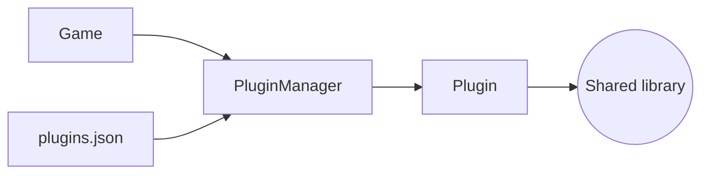

# Plugin

The `plugin` module loads shared libraries at run time and drives their lifecycle. A game builds a plugin as a shared library, lists it in a JSON configuration and calls it once per step, without linking it.

The headers are in `modules/plugin/include/younity/plugin/`, in the namespace `younity::plugin`. The module needs no other engine module than the logger, and uses nlohmann/json for the configuration and the dynamic loader of the system, `dlopen` on Linux and macOS and `LoadLibraryW` on Windows.



The game gives a configuration file to the manager, the manager loads each library it lists into a `Plugin`, and the game drives the plugins through `start`, `update` and `stop`.

## Writing a plugin

A plugin exports one C function, declared by `YOUNITY_PLUGIN_DESCRIPTOR`, which returns a pointer to a `PluginDescriptor` with static storage. The descriptor gives the name and the version of the plugin, its ABI version and the callbacks of its lifecycle.

```cpp
#include "younity/plugin/PluginAPI.hpp"

namespace {

struct Weapons
{
    void start(void) {}
    void update(double /* deltaTime */) {}
    void stop(void) {}
};

void *create(void)
{
    return new Weapons;
}

void destroy(void *context)
{
    delete static_cast<Weapons *>(context);
}

void start(void *context)
{
    static_cast<Weapons *>(context)->start();
}

void update(void *context, double deltaTime)
{
    static_cast<Weapons *>(context)->update(deltaTime);
}

void stop(void *context)
{
    static_cast<Weapons *>(context)->stop();
}

const younity::plugin::PluginDescriptor DESCRIPTOR{
    .abiVersion = YOUNITY_PLUGIN_ABI_VERSION,
    .name = "weapons",
    .version = "1.0.0",
    .create = create,
    .destroy = destroy,
    .start = start,
    .update = update,
    .stop = stop,
};

} // namespace

YOUNITY_PLUGIN_DESCRIPTOR
{
    return &DESCRIPTOR;
}
```

`create` runs when the library is loaded, `start` before the first update, `update` once per call of the game, and `stop` before the context is destroyed. A context may be null when the plugin has no state. The callbacks are C functions: they must not throw, because the engine cannot catch an exception across the C ABI.

`YOUNITY_PLUGIN_ABI_VERSION` is the version of the descriptor and of the callbacks. The engine refuses a plugin built for another version, so a changed layout is never read with the wrong types.

## Loading one plugin

`Plugin::loadFromFile` opens a library, checks its descriptor and creates the context. It returns the plugin or a `PluginError`:

```cpp
const std::expected<younity::plugin::Plugin, younity::plugin::PluginError> plugin =
    younity::plugin::Plugin::loadFromFile("plugins/weapons.so");

if (!plugin) {
    // plugin.error().code, plugin.error().message
}
```

| Type          | Role                                                             |
|---------------|------------------------------------------------------------------|
| `Plugin`      | One loaded library, its descriptor and its context               |
| `PluginError` | The code, the path, the line of a JSON error and a message       |
| `toString`    | A short description of a `PluginErrorCode`                       |

`getName`, `getVersion` and `getPath` describe the loaded plugin. `start`, `update` and `stop` call the callbacks, and both `start` and `stop` are idempotent. `unload` stops the plugin, destroys its context and closes the library; the destructor does the same. A `Plugin` is move-only: a move keeps the library loaded and leaves the moved-from object empty.

A load fails with `NotFound` when the file does not exist, `OpenFailed` when the system cannot open it, `MissingDescriptor` when the symbol is absent, `AbiMismatch` when the version differs, and `InvalidDescriptor` when a name, a version or a callback is missing.

## The configuration

`PluginManager` reads a JSON file that lists the libraries to load. A relative path is resolved from the folder of the configuration file:

```json
{
    "plugins": [
        "plugins/weapons.so",
        "plugins/levels.dll"
    ]
}
```

```cpp
younity::plugin::PluginManager plugins;

const std::expected<void, younity::plugin::PluginError> loaded = plugins.loadFromFile("plugins.json");

if (loaded) {
    plugins.start();
}
```

The configuration is an object with one key, `"plugins"`, holding an array of non-empty strings. An unknown key, another type or a malformed document is an `InvalidConfig` error; a JSON syntax error also gives the line. The manager loads every library into a temporary list first, so a failure leaves the current plugins untouched. On success, it stops the current plugins and replaces them with the new ones, which the next `start()` starts.

`start()` starts the plugins in the order of the configuration, `update(deltaTime)` calls them in the same order, and `stop()` stops them in the reverse order. `clear()` stops and unloads every plugin, and the destructor calls `clear()`.

## In the game loop

The game loads its plugins in `onStart` and updates them once per fixed step:

```cpp
class MyGame : public younity::Application
{
public:
    MyGame(void) : younity::Application(1.0F / 60.0F) {}

protected:
    void onStart(void) override
    {
        const std::expected<void, younity::plugin::PluginError> loaded = this->_plugins.loadFromFile("plugins.json");

        if (!loaded) {
            return;                 // loaded.error() tells why
        }
        this->_plugins.start();
    }

    void onFixedUpdate(float step) override
    {
        this->_plugins.update(step);
    }

private:
    younity::plugin::PluginManager _plugins;
};
```

The manager stops and unloads its plugins in its destructor.

## Building a plugin

`younity_add_plugin` creates a shared library with no `lib` prefix, compiled as C++23 with position-independent code and the warnings of the engine. The sources are explicit, and `DEPENDS` lists the engine modules of the plugin: `plugin` for the descriptor header, `core` for the math types, and the other modules it calls.

```cmake
CPMAddPackage(
    NAME Younity
    SOURCE_DIR "${CMAKE_CURRENT_SOURCE_DIR}/../younity-engine"
)

younity_add_plugin(weapons
    SOURCES weapons.cpp
    DEPENDS plugin core
)
```

The target file is `weapons.so` on Linux and macOS, and `weapons.dll` on Windows. `LIBRARIES` adds external libraries or the game's own targets when the plugin needs them.

The engine modules are static libraries, so a plugin that lists one links its own copy of it, with its own globals: the loggers and the metrics store of a plugin are not the ones of the game. The engine gives the plugin no pointer to the game either, so a plugin that needs the game state gets it from an API the game exports.

## Limits

The plugin ABI is the descriptor and its callbacks, and it is checked when the library is loaded. A plugin built for another ABI version is refused; a plugin built against the same ABI but a different build of the engine loads, because nothing else crosses the boundary.

There is no automatic reload: `loadFromFile` replaces the set of plugins, and the game calls `start()` again. A plugin loaded twice is two independent copies of its context.
