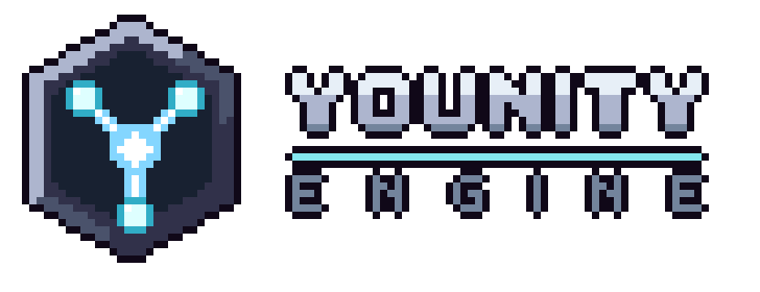

---
hide:
  - navigation
  - toc
---

{ .hero-logo }

# A modular 2D game engine in C++23

Younity is a set of libraries that any 2D game can link: entities and systems, physics, rendering, input, audio and networking.

[Get started](getting-started/index.md){ .md-button .md-button--primary }
[API reference](api/annotated.md){ .md-button }

## Explore the documentation

-   :material-rocket-launch-outline:{ .lg .middle } **Getting started**

    ---

    Build the engine, run its tests and link it in your own game.

    [:octicons-arrow-right-24: Build the engine](getting-started/index.md)

-   :material-layers-triple-outline:{ .lg .middle } **Architecture**

    ---

    The modules of the engine, what each one depends on and how they work together.

    [:octicons-arrow-right-24: Read the overview](architecture/index.md)

-   :material-book-open-page-variant-outline:{ .lg .middle } **Guides**

    ---

    Step-by-step tutorials, starting with your first entity and system.

    [:octicons-arrow-right-24: Follow a guide](guides/index.md)

-   :material-scale-balance:{ .lg .middle } **Technical study**

    ---

    The technologies, algorithms and data structures of the engine, compared with their alternatives.

    [:octicons-arrow-right-24: Read the study](study/index.md)

-   :material-source-merge:{ .lg .middle } **Contributing**

    ---

    The git workflow, the code style and how this documentation is written.

    [:octicons-arrow-right-24: Start contributing](contributing/index.md)

-   :material-code-braces:{ .lg .middle } **API reference**

    ---

    Every class and function of the public headers, generated from the code.

    [:octicons-arrow-right-24: Browse the classes](api/annotated.md)

## Games built on Younity

The engine is generic: two games of different kinds link it, and share no code.

| Game                                                         | What it is                                     | What it shows of the engine                                     |
|--------------------------------------------------------------|------------------------------------------------|-----------------------------------------------------------------|
| [J-Type](https://github.com/Rimapus/r-type/tree/main/j-type)    | A networked shoot'em up for up to four players | The network module, a server and a client, written in C++       |
| [J-Climb](https://github.com/Rimapus/r-type/tree/main/j-climb)  | A precision platformer in ten rooms            | A game written almost entirely in Lua, see [Write a game in Lua](guides/lua-game.md) |

J-Type starts J-Climb with the Konami code on its main menu.

## Part 2 track

For the second part of the R-Type project, the team chose the **advanced architecture** track: build a real game engine, generic and standalone, rather than a game with its engine inside.

| What the engine does | Where it is described |
|---|---|
| A modular engine: 13 modules, each its own library, that a game links only when it uses them | [Architecture](architecture/index.md) |
| Generic and standalone: J-Type and J-Climb, two games of different kinds, link it and share no code | [Games built on Younity](#games-built-on-younity) |
| An entity component system, with scenes saved to and loaded from files | [ECS](architecture/ecs.md) |
| The behaviour of the entities in Lua scripts, run again when their file is saved | [Scripting](architecture/scripting.md) |
| Shared libraries loaded at run time | [Plugin](architecture/plugin.md) |
| An editor and debug tools inside the game: entity list, inspector, scene files, console and metrics | [Editor](architecture/editor.md) |
| A separate CMake project, linked by both games through CPM | [Use it in a game](getting-started/use-in-a-game.md) |

## Modules

Each module is a library, so a game links only what it uses.

| Module      | What it does                                              |
|-------------|-----------------------------------------------------------|
| `logger`    | Log messages with levels, to the console or to a file     |
| `core`      | Math types, clock and fixed timestep, events, main loop   |
| `tools`     | Metrics, console variables and commands                   |
| `plugin`    | Shared libraries loaded at run time                       |
| `ecs`       | Entities, components, systems and scenes                  |
| `scripting` | Lua scripts that give an entity its behaviour             |
| `physics`   | Gravity, solids, hitboxes and collision detection         |
| `assets`    | Loading and caching of textures, fonts and sounds         |
| `render`    | Window, sprites, animations, particles and text           |
| `input`     | Keyboard and gamepad, through actions that can be rebound |
| `audio`     | Music and sound effects                                   |
| `network`   | UDP sockets, binary serialization, packets, threaded I/O  |
| `editor`    | Entity list, inspector, scene files, assets, console, metrics, layouts |
